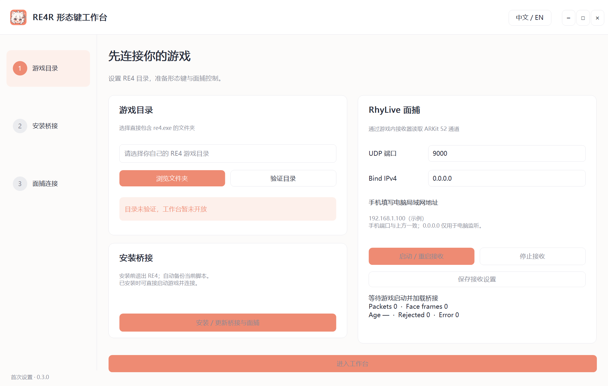

# RE4R ShapeKey Studio

Windows 桌面形态键工作台，通过 REFramework 桥接 DLL 控制 RE4 Remake 的自定义形态键，支持 RhyLive ARKit 面捕。



当前版本 0.3.0，实验阶段。浅色珊瑚界面，中英文切换。

- 初始化页选择并验证含 `re4.exe` 的游戏目录；未验证时不能进入实际控制面板。
- GUI 内安装/更新桥接，备份当前脚本并保留已有修改。
- 表情、捏脸、身体/服装、头发/兽耳分组，滑条、数值输入、搜索、预设、对比与巡检。
- 多网格回读与写入上限保护，模型变化后释放控制，断连恢复先前状态。
- RhyLive 接收端口/绑定 IPv4、启动/停止、Packets/Face frames/Age 等状态集中到桌面。
- 新生成的二次元猫耳图标，用于界面和 EXE 图标资源。

## 使用

1. 安装适配当前 RE4 的 REFramework，以及带自定义形态键和配置的模型 MOD。本仓库不包含角色模型、游戏资源或形态键 MESH 资产。
2. 构建并把 `build/package` 解压/保存在可写目录；启动 `RE4R_ShapeKeyStudio.exe`。
3. 在初始化页选择直接包含 `re4.exe` 的目录，点击验证。
4. 退出游戏，点击“安装 / 更新桥接与面捕”，等待完成。备份在程序目录 `backups/`，详细日志在 `installer.log`。
5. 启动游戏并进入存档；进入工作台，确认模型连接，再开始控制。
6. 手机 RhyLive 无线发送目标填写初始化页显示的电脑局域网 IPv4，端口默认 9000。电脑 Bind IPv4 默认 `0.0.0.0`；它不是手机目标地址。
7. 在 GUI 启动接收，确认 Face frames 持续增长；来源选 RhyLive + 微调或面捕 / 原生回落。此路线会关闭旧面骨驱动，避免竞争。

桌面到游戏使用本机命名管道，无需桌面通信地址或端口。手机到电脑使用 UDP。离线 `--demo` 仅用于查看界面，所有操作都不写游戏，也不安装桥接。

游戏目录保存在程序旁 `Studio.settings.ini`，启动时重新验证；不会硬编码任何人的 Steam 路径。身体/头发等键需要模型 MOD 的对应模块，未绑定的键禁用。

## 构建

Windows x64、Zig、Lua 5.4 C 源码。无需 .NET/Python 运行时。REFramework API.h 及其许可证随源码提供。

```powershell
.\Build.ps1 -Zig "zig.exe" -LuaSourceDirectory "C:\tools\lua-5.4\src"
.\scripts\Test.ps1
```

Lua 源码另行取得；本仓库不上传本机工具、缓存、编译产物或模型素材。安装器优先追加接口到游戏中已有脚本，失败会恢复备份；没有现有脚本时使用随包的运行脚本。

## 验证与限制

本版已做本地编译、DLL/Lua/桌面管道测试、模型变化/断连恢复测试、多网格边界保护测试、初始化目录门禁、端口/IP 校验、接收器接口及重复安装保留原脚本的隔离测试。Windows Shell 已识别嵌入图标。

**本轮尚未确认 0.3.0 在真实 RE4 中的 GUI 联动、面捕和实际任务栏显示。** 带形态键模型的游戏内效果还需独立验证。GUI 的静态缩略图不是游戏实时预览。

## 目录与许可

`src/` 桌面与桥接代码，`runtime/` 游戏内 Lua 和面捕模块，`tests/` 桩测试，`assets/` 图标与离线通道数据。

项目整体开源许可证尚未指定；公开仓库不等同于授予任意再分发许可。REFramework、Lua、RhyLive 相关第三方代码保留各自许可证，见 `vendor/` 与构建包的许可证文件。
